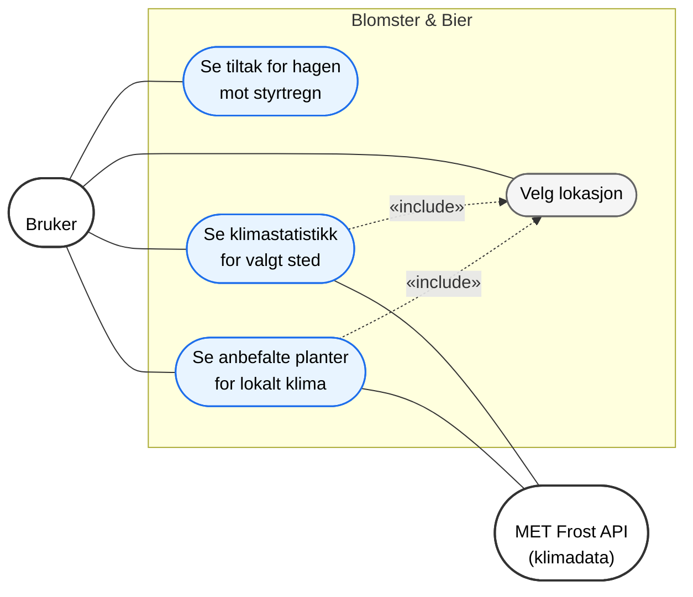
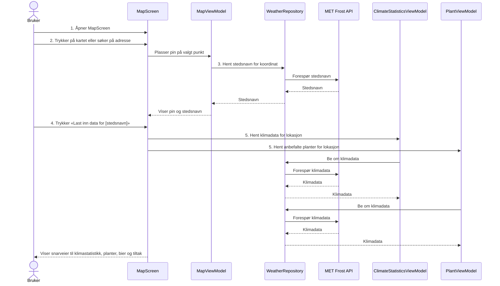
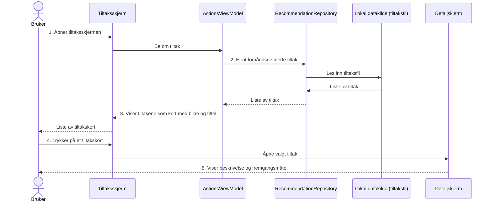
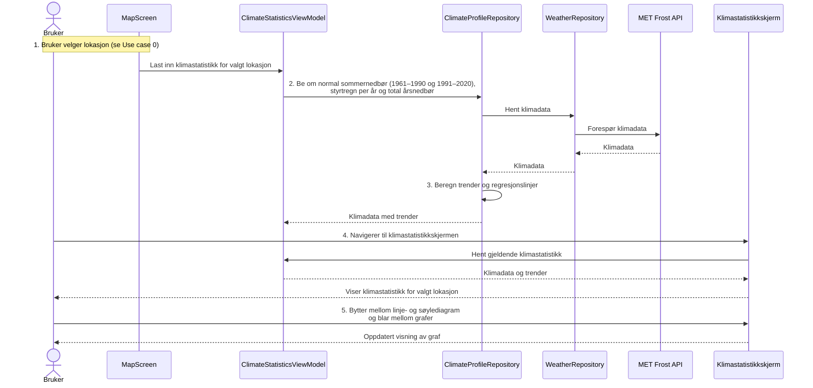
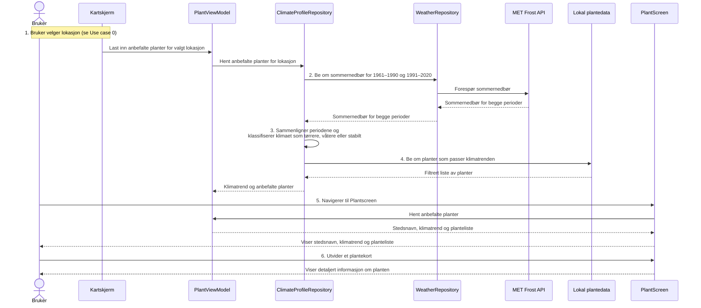
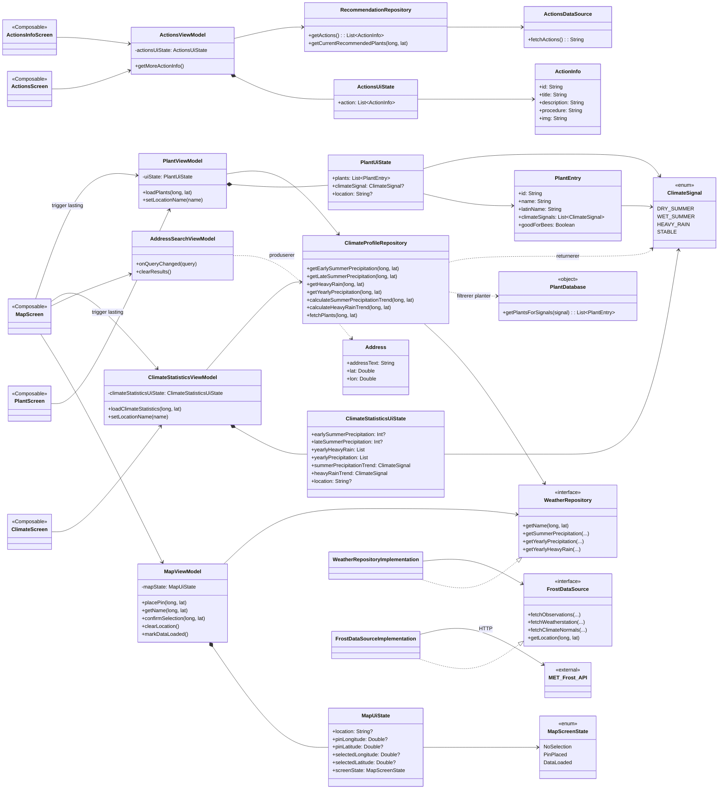
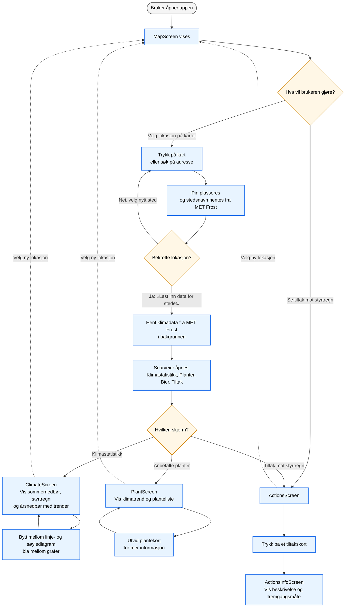

# Use-case diagram

Diagrammet er valg for å illustrere de viktigste use-cases for vår app. Her har vi valgt å inkludere 4 use cases:

0. Velg lokasjon
1. Se tiltak for hagen mot styrtregn
2. Se klimastatistikk for valgt sted
3. Se anbefalte planter for lokalt klima
    

# Use Case 0 – Velg lokasjon (seksvensdiagram)

Use case 0 (inkludert i Use case 2 og 3): Velg lokasjon
1.	Brukeren åpner kartskjermen
2.	Brukeren velger et sted ved å trykke på kartet eller søke på en adresse
3.	Systemet plasserer en pin på valgt punkt og henter stedsnavn fra MET Frost
4.	Brukeren bekrefter valget ved å trykke «Last inn data for [stedsnavn]»
5.	Systemet henter klimadata for det valgte stedet i bakgrunnen og åpner opp snarveier til de andre skjermene (klimastatistikk, planteskjerm, tiltak mot styrtregn og tiltak for bier)

Vi har valgt å bruke sekvensdiagrammer for å illustrere de viktige use-cases (illustrert ovenfor). Dette er for å gi et bedre innblikk i hvordan programmet håndterer disse.

# Use Case 1 – Se tiltak for hagen mot styrtregn (seksvensdiagram)

Use case 1: Se tiltak for hagen mot styrtregn
1.	Brukeren åpner tiltaksskjermen 
2.	Systemet leser inn de forhåndsdefinerte tiltakene fra appens lokale data
3.	Systemet viser tiltakene som en liste av kort med bilde og tittel
4.	Brukeren trykker på et tiltakskort
5.	Systemet viser en detaljskjerm med beskrivelse og fremgangsmåte for det valgte tiltaket

# Use Case 2 - Se klimastatistikk for valgt sted (seksvensdiagram)

Use case 2: Se klimastatistikk for valgt sted
1.	Brukeren velger lokasjon (se Use case 0)
2.	Systemet henter klimadata fra MET Frost for det valgte stedet: normal sommernedbør for to perioder, antall timer styrtregn per år og total årsnedbør de siste årene
3.	Systemet beregner trender og regresjonslinjer for nedbør og styrtregn
4.	Brukeren navigerer til klimastatistikkskjermen, og systemet viser klimastatistikk for valgt lokasjon
5.	Brukeren kan bytte mellom linje- og søylediagram og bla mellom grafene for sommernedbør, styrtregn og årsnedbør

# Use Case 3 - Se anbefalte planter for lokalt klima (seksvensdiagram)

Use case 3: Se anbefalte planter for lokalt klima
1.	Brukeren velger lokasjon (se Use case 0)
2.	Systemet henter normaler for sommernedbør for periodene 1961–1990 og 1991–2020 fra MET Frost
3.	Systemet sammenligner periodene og klassifiserer klimaet på stedet som tørrere, våtere eller stabilt
4.	Systemet velger ut planter som passer til den beregnede klimatrenden
5.	Brukeren navigerer til planteskjermen, og systemet viser stedsnavn, klimatrend og en liste med anbefalte planter
6.	Brukeren kan utvide et plantekort for å se mer informasjon om en plante

# Klassediagram for use-cases og sekvensdiagrammer

Vi har valgt å inkludere et klassediagrm for å gi en oversikt over de viktigste klassene som inngår i use-cases vi har presentert ovenfor. 

Vi har valgt å implementere et flytdiagram for å gi et mindre teknisk--og mer tilgjengelig--overblikk over vår applikasjons viktigste use-cases. 

